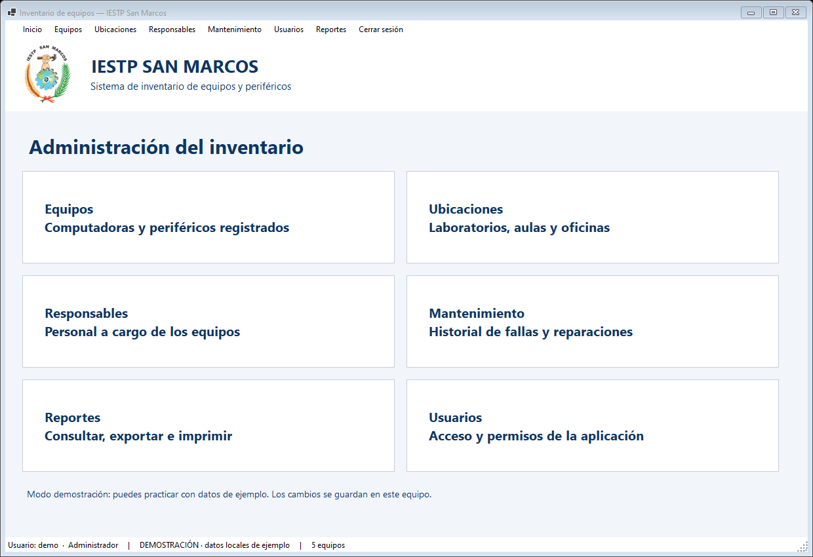
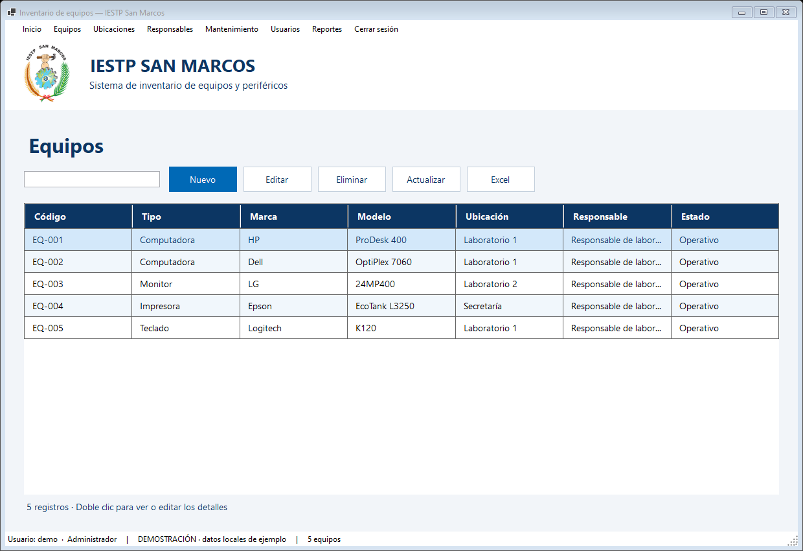
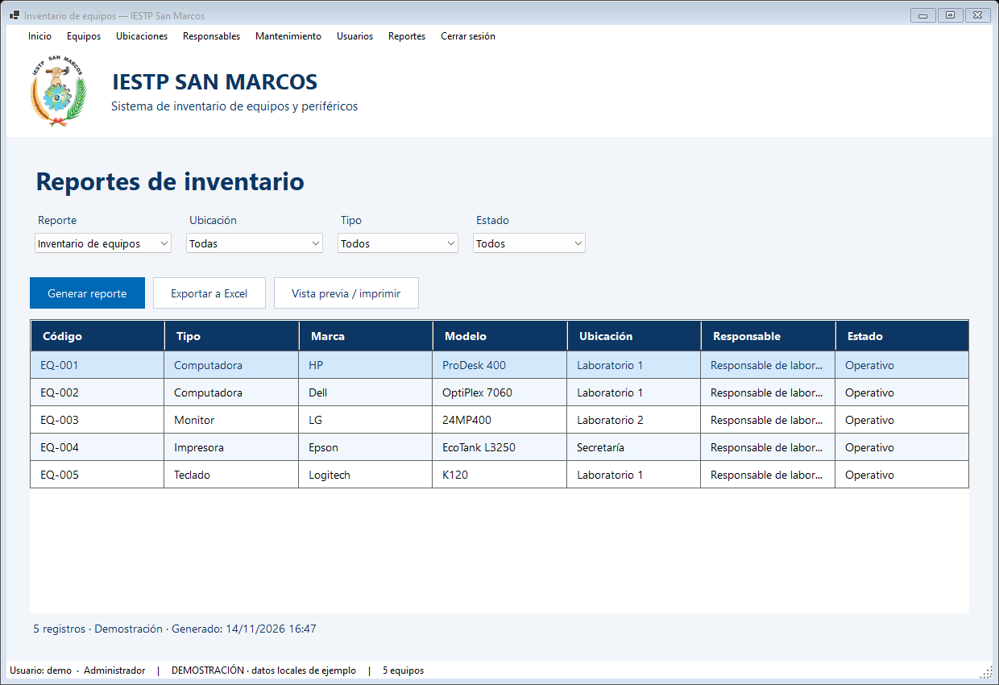
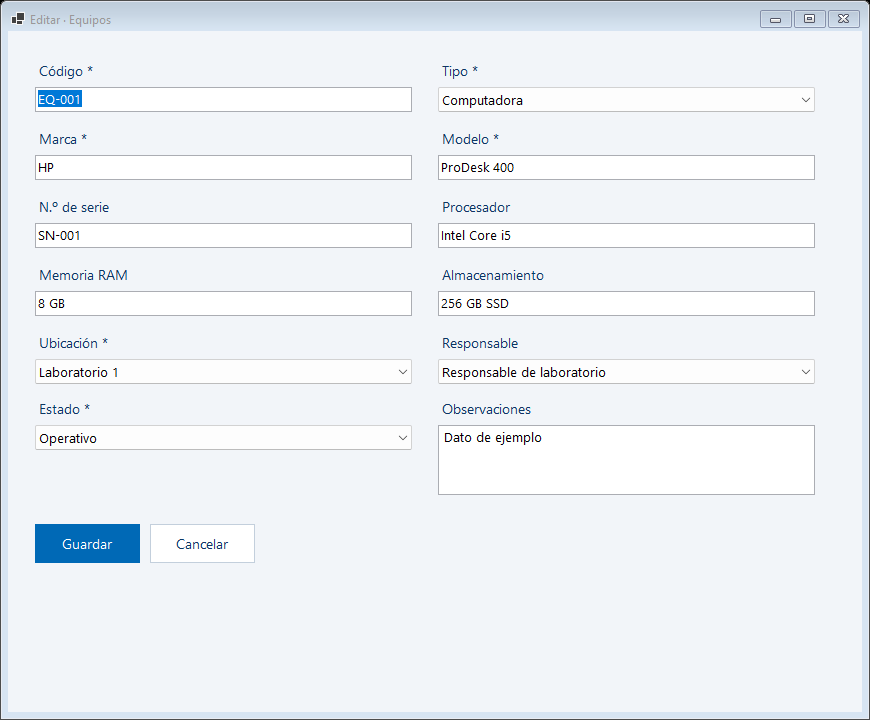

# Inventario de equipos — IESTP San Marcos

Aplicación de escritorio para registrar computadoras y periféricos, organizar su ubicación y responsable, llevar un historial de mantenimiento y generar reportes.

Recreación en **C# y .NET 10** de un sistema académico desarrollado originalmente en Visual Basic .NET con SQL Server.



## Funciones

- Equipos: registro, edición, búsqueda, eliminación y control de códigos y números de serie únicos.
- Ubicaciones: laboratorios, aulas y oficinas.
- Responsables: personal a cargo de los equipos.
- Mantenimiento: servicios preventivos y correctivos, fecha, técnico, detalle, costo y estado.
- Reportes: inventario por ubicación, tipo y estado; listado de mantenimientos por estado.
- Exportación a archivos `.xlsx` sin requerir Excel instalado.
- Vista previa e impresión con paginación. Puede guardarse como PDF mediante una impresora PDF instalada en Windows.
- Usuarios: administrador y encargado, contraseñas con PBKDF2-SHA256 y protección del último administrador.
- Dos orígenes de datos independientes: demostración local y SQL Server.

## Probar la aplicación

1. Descomprime la distribución **Windows x64** completa en una carpeta.
2. Abre `InventarioSanMarcos.exe`.
3. En el primer acceso, crea tu usuario administrador y una contraseña de al menos 10 caracteres. No se incluye una contraseña predeterminada.
4. El origen inicial es **Demostración** e incluye cinco equipos de ejemplo. Tus cambios se conservan localmente.

La distribución contiene el entorno de ejecución de .NET. El código fuente requiere el SDK por separado.

## Configurar SQL Server

1. Instala SQL Server Express o LocalDB y una herramienta para ejecutar scripts, como SQL Server Management Studio.
2. Ejecuta [`database/01-schema.sql`](database/01-schema.sql) en la instancia elegida. Crea la base `InventarioSanMarcos` sin eliminar tablas existentes.
3. En la pantalla de acceso, pulsa **Origen de datos**, selecciona **SQL Server** y configura la conexión.
4. Ejemplo para LocalDB con autenticación de Windows:

   ```text
   Server=(localdb)\MSSQLLocalDB;Database=InventarioSanMarcos;Integrated Security=True;Encrypt=True;TrustServerCertificate=True;Connect Timeout=8
   ```

5. Crea el administrador de esa base en el primer acceso. Luego registra las ubicaciones y responsables antes de crear equipos.

`TrustServerCertificate=True` permite el certificado local de desarrollo. Para un servidor compartido, utiliza un certificado válido y `TrustServerCertificate=False`. Se recomienda autenticación integrada para no guardar contraseñas del servidor en la configuración local. Asigna a cada identidad de Windows los permisos de lectura y escritura que correspondan; los roles de la interfaz no sustituyen los permisos de SQL Server.

Los registros de demostración no se importan automáticamente a SQL Server. Cada origen conserva sus propios usuarios y registros.

## Compilar

Requisitos: Windows x64, [SDK de .NET 10](https://dotnet.microsoft.com/download/dotnet/10.0) y un editor compatible. La solución puede abrirse en Visual Studio con la carga de desarrollo de escritorio de .NET.

```powershell
dotnet restore InventarioSanMarcos.sln
dotnet build InventarioSanMarcos.sln -c Release
dotnet run --project src/InventarioSanMarcos
```

Publicar una carpeta que incluya .NET:

```powershell
dotnet publish src/InventarioSanMarcos -c Release -r win-x64 --self-contained true -p:DebugType=None -p:DebugSymbols=false -o artifacts/windows-x64
```

## Pruebas

```powershell
dotnet src/InventarioSanMarcos/bin/Release/net10.0-windows/InventarioSanMarcos.dll --self-test
```

El resultado se escribe en `pruebas.txt` junto al ejecutable. Las pruebas usan una carpeta temporal independiente y comprueban autenticación, restricciones de registros, persistencia y estructura del archivo Excel. No acceden a la base de producción. La integración con SQL Server requiere una instancia disponible y debe validarse siguiendo la [guía de pruebas](docs/PRUEBAS.md).

`--preview` abre una sesión temporal con datos de ejemplo para inspeccionar la interfaz. No abre SQL Server ni los archivos de demostración guardados por el usuario; sus cambios se descartan al cerrar.

## Pantallas





## Estructura

```text
src/InventarioSanMarcos/   Aplicación Windows Forms, reglas y acceso a datos
database/                 Creación de la base SQL Server
docs/                     Guías y capturas de la aplicación
.github/workflows/        Compilación, pruebas y distribución en Windows
```

Configuración y datos de demostración: `%LOCALAPPDATA%\InventarioSanMarcos`. Esta carpeta puede contener información personal y no forma parte del repositorio. No subas archivos de configuración con credenciales, copias de bases de datos ni inventarios reales.

El estado de un mantenimiento y el estado general del equipo se registran por separado: cerrar un servicio no cambia automáticamente el equipo a operativo. Un equipo con historial de mantenimiento no puede eliminarse mientras tenga registros relacionados.

La identidad gráfica corresponde al IESTP San Marcos y se incluye como referencia institucional del proyecto académico.
